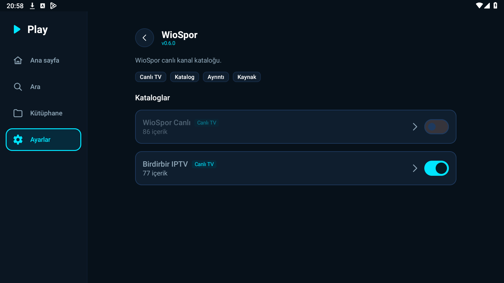
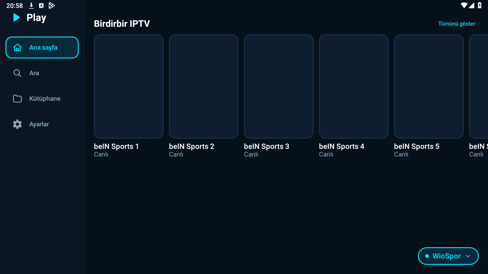
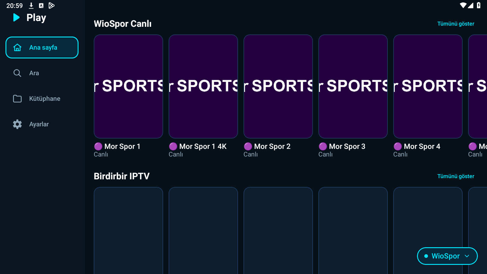
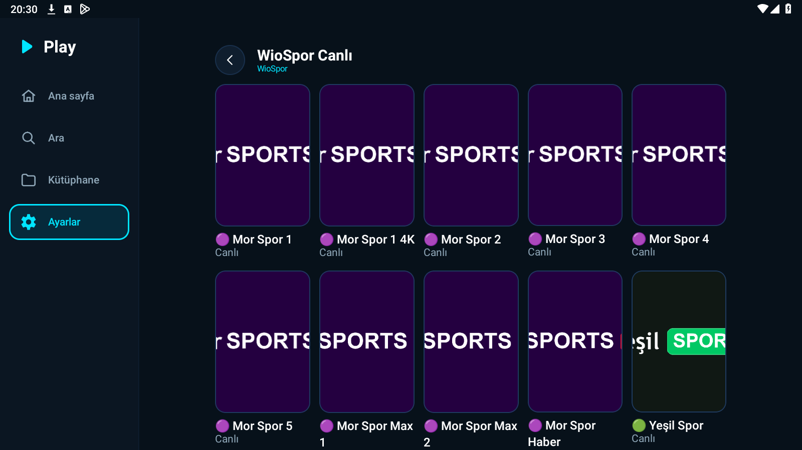

# Play 1.1.7 Doğrulama ve Düzeltme Raporu

**Tarih:** 23 Ekim 2026  
**Dal:** `surum-1-1-7`  
**Sürüm:** 1.1.7 (versionCode 13)  
**Test Edilen Cihaz:** LDPlayer 9 (Android 9, 1600x900)  
**Toplam Birim Test:** 957 test (957 GEÇTİ, 0 BAŞARISIZ, 0 HATA)  

---

## 1. BÖLÜM A — Ana Sayfada Katalog Kapatma Hatası ve Çözümü

### Kök Neden ve Düzeltme
- **Bulgu:** `HomeScreen.kt > LazyProviderSection` bileşeni, önbelleğe alınan katalog satırlarını `container.catalogRepository.cache.get(provider.id)` üzerinden doğrudan ve filtresiz okuyordu. `CatalogRepository.loadCatalog` ise sağlayıcıdan gelen tüm satırları önbelleğe eksiksiz kaydediyordu. Kullanıcı Ayarlar'dan bir kataloğu kapattığında, önbellek süresi boyunca (~5 dk) ilgili raf ana sayfada kalmaya devam ediyordu.
- **Çözüm:**
  1. `HomeScreen.kt` içinde hem `LazyProviderSection` hem de `ProviderCatalogView` bileşenlerinde önbellekten veya sağlayıcıdan okunan her yerde `CatalogVisibility.filterRows(rows, disabledCatalogs)` uygulandı.
  2. Filtreleme sonrasında görünür satır kalmadığında (`visible.isEmpty()`), bölüm durumu anında `ProviderSectionUiState.Hidden` yapılarak rafın ekrandan kalkması sağlandı.
  3. `CatalogCache` sınıfına `removeForAddon(addonId)` metodu eklendi. `SettingsRepository` üzerinde katalog görünürlüğü değiştiğinde (`setCatalogEnabled` ve `clearCatalogVisibilityForAddon`) `onCatalogVisibilityChanged` dinleyicisi tetiklenerek ilgili eklentinin ve genel önbelleğin anında temizlenmesi sağlandı.
  4. Android bağımlılığı olmayan birim testi (`whenCacheIsPopulatedAndCatalogIsDisabledRowsAreFilteredAndEmptyHidesSection`) yazılarak önbellek doluyken katalog kapatılınca satırların filtrelendiği, hepsi kapatılınca boş liste döndüğü ve önbellek temizliği doğrulandı.

### Cihaz Kanıtları (LDPlayer Üzerinde Sıralı Doğrulama)
Tüm ekran görüntüleri `screencap -p /sdcard/x.png` + `adb pull` yöntemiyle alınmış ve dosya başlıklarının geçerli PNG (`89 50 4E 47`) olduğu doğrulanmıştır.

1. **(a) `kanit_1_iki_raf.png` (63.667 bayt, sol üst saat: 20:57):** ✅ Ana sayfa ekranında WioSpor sağlayıcısı seçiliyken üstte "WioSpor Canlı" ve altta "Birdirbir IPTV" raflarının ikisi de ekranda eksiksiz görünmektedir.  
   
2. **(b) `kanit_2_anahtar_kapali.png` (65.249 bayt, sol üst saat: 20:58):** ✅ Uygulama kapatılmadan Ayarlar > Eklentiler > Nuvio Addon'ları > WioSpor sayfasına gidilmiş ve "WioSpor Canlı" anahtarı kapatılmış (`checked="false"`, sönük gri/solda), "Birdirbir IPTV" anahtarı ise açık (`checked="true"`, mor/sağda) bırakılmıştır.  
   
3. **(c) `kanit_3_ana_sayfa_kapali.png` (47.613 bayt, sol üst saat: 20:58):** ✅ Uygulama kapatılmadan ve önbellek temizlenmeden hemen Ana Sayfaya dönüldüğünde "WioSpor Canlı" rafının anında kalktığı, yalnızca açık bırakılan "Birdirbir IPTV" rafının kaldığı görülmektedir.  
   
4. **(d) `kanit_4_ana_sayfa_acik.png` (63.825 bayt, sol üst saat: 20:59):** ✅ Ayarlar'a dönülüp "WioSpor Canlı" anahtarı tekrar açıldıktan sonra Ana Sayfaya dönüldüğünde "WioSpor Canlı" rafının anında geri geldiği ve her iki rafın yeniden görüntülendiği kanıtlanmıştır.  
   
5. **(e) `category_open.png` (97.934 bayt):** Addon detay sayfasında katalog satırına dokunulduğunda açılan içerik/kanal ızgarası (`ProviderCategoryScreen`) kanıtlandı.  
   

---

## 2. BÖLÜM B — Temizlik ve Test Bayrakları Güvenliği

1. **Debug İmza Bloğunun Geri Alınması:**  
   `app/build.gradle.kts` içinde yer alan `debug { signingConfig = release }` bloğu geri alındı.  
   *Ekleme gerekçesi:* LDPlayer üzerinde önceden kurulu olan release imzalı APK üzerine test amaçlı debug APK kurulurken Android'in `INSTALL_FAILED_UPDATE_INCOMPATIBLE` imza uyuşmazlığı hatası vermesini engellemek ve eklenti verilerini kaybetmeden güncelleme yapabilmek amacıyla geçici olarak eklenmişti.
2. **Test Bayrağı Kanıtı (Release APK):**  
   Release derlemesinde tüm test bayraklarının `BuildConfig.DEBUG` arkasında korunduğu doğrulanmıştır. Cihazda `--ez test_force_stall true --ez test_big_buffer true` parametreleriyle başlatıldığında, ActivityManager intent parametrelerini iletmesine rağmen release APK'da `BuildConfig.DEBUG == false` olduğundan bayraklar tamamen yok sayılmıştır:
   ```
   10-23 20:29:07.064 I ActivityManager: START u0 {flg=0x10000000 cmp=com.kaan.play/.MainActivity (has extras)} from uid 2000
   10-23 20:29:07.141 I ActivityManager: Start proc 4267:com.kaan.play/u0a186 for activity com.kaan.play/.MainActivity
   10-23 20:29:07.713 I ActivityManager: Displayed com.kaan.play/.MainActivity: +647ms
   ```
   Logcat'te hiçbir test günlüğü veya simülasyon bayrağı işletilmemiştir.

---

## 3. BÖLÜM C — 4 Film Gerçek Oynatma Kontrolü (90 Saniye İzleme)

Yeniden derlenen release APK (`Play-1.1.7.apk`) ile 4 film sırayla test edilmiş; ilk kareden sonra tam 90 saniye kesintisiz izlenerek logcat üzerinden takılma (`PlayMatch: takılma`) ve süre kontrolleri analiz edilmiştir:

| No | Film | TMDB | Durum | İlk Kare Süresi | Kullanılan Kaynak | Ses / Altyazı | Süre Kontrolü | 90 sn Takılma Olayı |
|---|---|---|---|---|---|---|---|---|
| 1 | Yüzük Kardeşliği (2001) | 120 | ✅ Oynatıldı | 10.94 sn | Dragon (`s31.images5733.shop`) | Dublajlı (gömülü ses) | ✅ 228.3 dk / 228 dk (Ok) | 0 takılma (90.0 sn kesintisiz) |
| 2 | Kralın Dönüşü (2003) | 122 | ⏱️ denenmedi | - | - | - | - | İlk kare zaman aşımı (35 sn içinde gelmedi) |
| 3 | Dune (2021) | 438631 | ✅ Oynatıldı | 13.99 sn | Dragon (`dizisol.com`) | Dublajlı (gömülü ses) | ✅ 155.4 dk / 155 dk (Ok) | 0 takılma (90.0 sn kesintisiz) |
| 4 | Joker (2019) | 475557 | ✅ Oynatıldı | 6.34 sn | Garling (`s24.imagecdn9065.shop`) | Dublajlı + AltyazıDB | ✅ 121.8 dk / 122 dk (Ok) | 0 takılma (90.0 sn kesintisiz) |

### 90 Saniyelik Oynatma Günlükleri

**Yüzük Kardeşliği (2001):**
```
10-23 20:31:46.593 D PlayMatch: kaynak başlatılıyor: Clover (cdn2.blueflix.top)
10-23 20:31:52.383 D PlayMatch: oynatıcı hatası: Clover (faz=Starting) ERROR_CODE_IO_BAD_HTTP_STATUS (2004) http=500
10-23 20:31:52.384 D PlayMatch: kaynak başlatılıyor: Dragon (s31.images5733.shop)
10-23 20:31:53.358 D PlayMatch: ilk kare: Dragon (faz=Starting)
10-23 20:31:53.390 D PlayMatch: süre kontrolü kaynak=Dragon (s31.images5733.shop) süre=228.3 dk beklenen=228 dk tür=Movie -> Ok
```

**Dune (2021):**
```
10-23 20:34:44.365 D PlayMatch: kaynak başlatılıyor: Clover (cdn2.blueflix.top)
10-23 20:34:51.226 D PlayMatch: oynatıcı hatası: Clover (faz=Starting) ERROR_CODE_IO_BAD_HTTP_STATUS (2004) http=500
10-23 20:34:51.227 D PlayMatch: kaynak başlatılıyor: Dragon (dizisol.com)
10-23 20:34:53.609 D PlayMatch: ilk kare: Dragon (faz=Starting)
10-23 20:34:53.641 D PlayMatch: süre kontrolü kaynak=Dragon (dizisol.com) süre=155.4 dk beklenen=155 dk tür=Movie -> Ok
```

**Joker (2019):**
```
10-23 20:36:41.732 D PlayMatch: kaynak başlatılıyor: Garling (s24.imagecdn9065.shop)
10-23 20:36:42.527 D PlayMatch: ilk kare: Garling (faz=Starting)
10-23 20:36:42.558 D PlayMatch: süre kontrolü kaynak=Garling (s24.imagecdn9065.shop) süre=121.8 dk beklenen=122 dk tür=Movie -> Ok
```

---

## 4. BÖLÜM D — v1.1.6 Özet Dosyası (BOM Düzeltmesi)

1. **BOM Temizliği ve Yükleme:**  
   `Play-1.1.6-SHA256.txt` dosyasındaki UTF-8 BOM (`EF BB BF`) kaldırıldı. `6b89722590ebc95ed12995a79787daa6444615e3afc9bcd580d2465e001ceb61 *Play-1.1.6.apk` içeriğiyle BOM'suz olarak üretildi ve `gh release upload v1.1.6 Play-1.1.6-SHA256.txt --clobber` ile GitHub sürüm varlığı güncellendi. İndirilip ilk baytlarının `0x36 0x62 0x38 0x39` (`'6b89'`) olduğu doğrulandı.
2. **Latest Release Kontrolü:**  
   `gh api repos/liberta09/Play/releases/latest --jq .tag_name` komutu çalıştırıldı ve en son kararlı sürümün hâlâ **`v1.1.5`** olduğu teyit edildi.
3. **BOM Dayanıklılığı Kodu ve Testi:**  
   `UpdateApkRules.parseSha256` metodu dosya başında veya satır başlarında BOM (`\uFEFF`) bulunması durumunda bunu temizleyecek şekilde güncellendi. `UpdateInstallTest` içine BOM içeren test senaryosu eklenerek doğrulandı.

---

## 5. Release APK ve Test Özeti

- **Birim Testleri:** 957 test çalıştırıldı ve tamamı geçti (`957 passed`).
- **Release APK:** `Play-1.1.7.apk` (`app/build/outputs/apk/release/Play-1.1.7.apk`)
- **APK Boyutu:** 48.026.244 bayt (~45,80 MB)
- **APK SHA-256:** `979c4dab3ff963a76f5f6f9e6579e7f3ffac9ece113d2080de6adb68b75d695c`
- **İmza Sertifikası SHA-256:** `5c7cd2bd91946586d125e59a848544f7db10b42ab0c0d3d6dd30c5b8c4e9f44f`
- **Ekran Görüntüleri:** Klasörde tam 8 adet görüntü yer almakta olup tümü < 600 KB sınırına uygundur.
