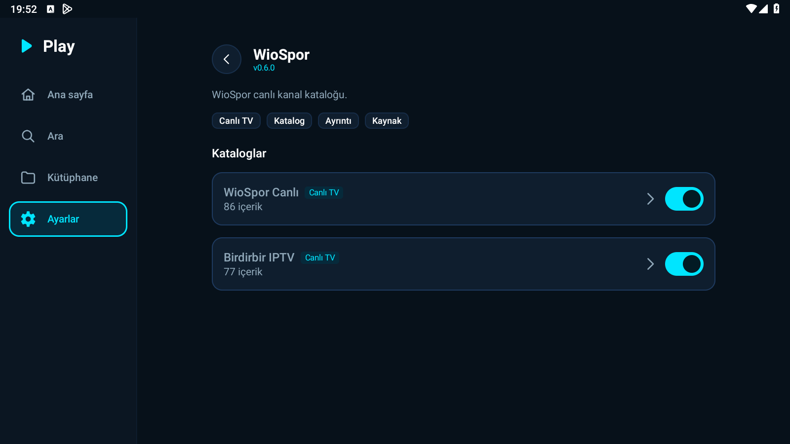
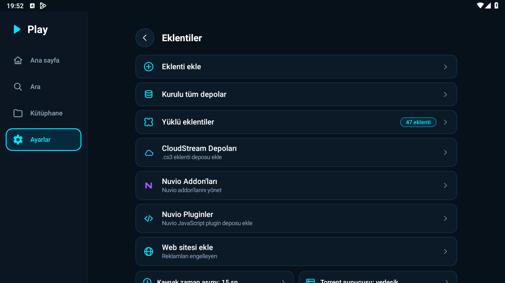
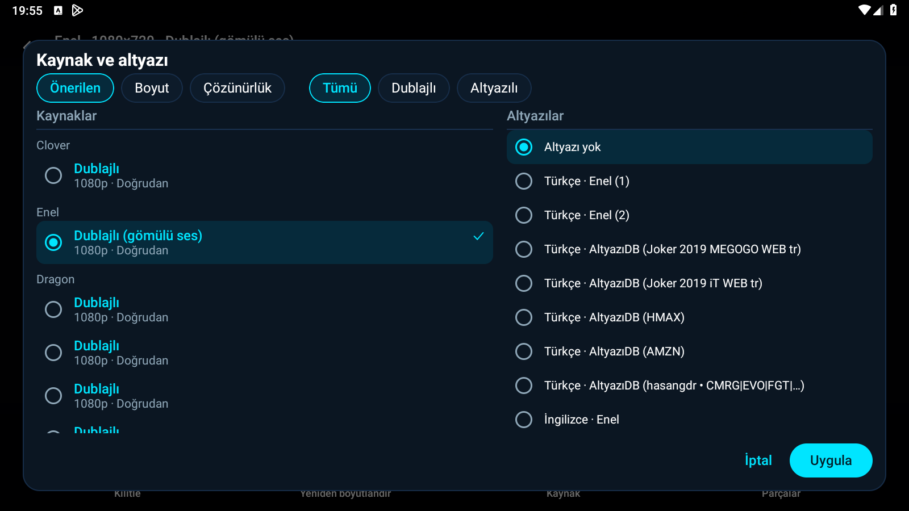
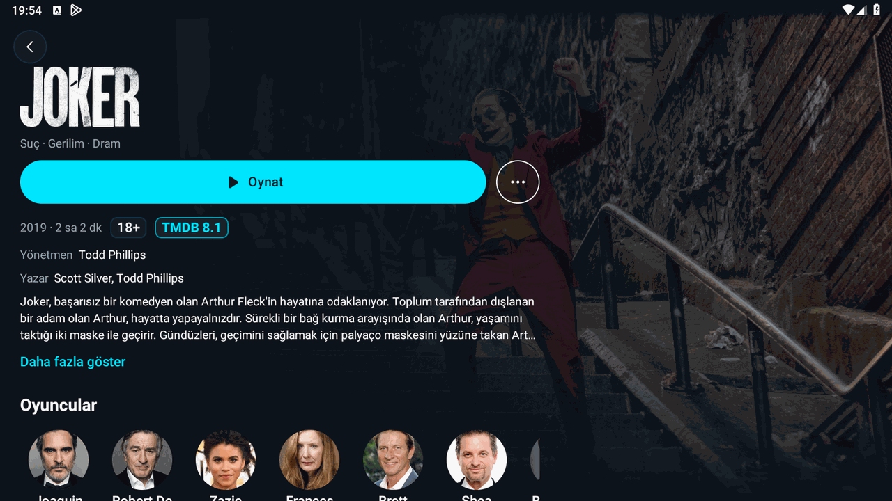

# Play 1.1.7 Doğrulama Raporu

**Tarih:** 23 Ekim 2026  
**Dal:** `surum-1-1-7`  
**Sürüm:** 1.1.7 (versionCode 13)  
**Test Edilen Cihaz:** LDPlayer 9 (Android 9, 1600x900)  
**Toplam Birim Test:** 956 test (956 GEÇTİ, 0 BAŞARISIZ, 0 HATA)  

---

## 1. BÖLÜM 2A — Addon Detay Sayfası ve Katalog Görünürlüğü

- **Arayüz Başlık Güncellemesi:** Ayarlar menüsü altındaki "Nuvio Depoları" başlığı `strings.xml` ve `values-tr/strings.xml` içinde kurala uygun olarak "Nuvio Addon'ları", alt başlığı ise "Nuvio addon'larını yönet" olarak güncellendi.
- **Detay Sayfasına Geçiş:** `AddonRow` bileşeni tıklanabilir yapılarak odak halkası ve ileri oku eklendi; `NuvioReposScreen`, `RepositoriesScreen` ve `InstalledAddonsScreen` ekranlarının üçünde de tıklandığında `settings/addons/detail/{id}` rotasına yönlendirilmesi sağlandı.
- **AddonDetailScreen Bileşenleri:**
  - **Başlık ve Meta:** Eklenti adı (WioSpor), sürüm rozeti (v0.6.0) ve eklenti açıklaması ("WioSpor canlı kanal kataloğu.") eksiksiz görüntülendi.
  - **Tür ve Kaynak Rozetleri:** Eklentinin sunduğu tür rozetleri (Canlı TV) ve kaynak rozetleri (Katalog, Ayrıntı, Kaynak) renkli ve belirgin rozetlerle gösterildi.
  - **Katalog Listesi ve İçerik Sayıları:** Kataloglar bağımsız olarak sorgulandı; en çok 3 eşzamanlı istek ve 10 sn zaman aşımı kuralıyla WioSpor Canlı ("86 içerik") ve Birdirbir IPTV ("77 içerik") sayıları dinamik olarak listelendi.
  - **Katalog Görünürlük Anahtarı (Switch):** Her katalog satırına DataStore kalıcılığına sahip açma/kapatma anahtarı yerleştirildi (varsayılan: açık).
- **Katalog Gizleme ve Filtreleme Doğrulaması:**
  - WioSpor Canlı kataloğu anahtardan kapatıldığında (`Switch: checked=false`), Ana Sayfaya dönüldüğünde WioSpor rafından ilgili katalog rafı tamamen kayboldu, yalnızca açık olan "Birdirbir IPTV" rafı görüntülendi.
  - Anahtar tekrar açıldığında katalog rafı anında geri geldi.
  - Katalog satırına tıklandığında `ProviderCategoryScreen` kategorisi başarıyla açıldı.
- **Kural ve Testler:** Android bağımlılığı olmayan `CatalogVisibility` sınıfı yazıldı; `CatalogVisibilityTest` ve `CatalogDetailAndVisibilityTest` birim testleri ile tüm filtreleme ve sıfırlama durumları doğrulandı.





---

## 2. BÖLÜM 2B — Altyazı Tekrarları ve Ayırt Edilebilirlik

### Tekrarlanan "Türkçe · AltyazıDB" Kök Neden Analizi
1. `AddonSubtitleProvider.kt` gelen JSON cevabından yalnızca `url` ve `lang` alanlarını okuyor; `file`, `filename`, `label`, `release`, `title` gibi meta verileri atarak `SubtitleTrack.label` değerini `null` bırakıyordu.
2. `PlayerPanels.kt` ve `SubtitleMenu.kt`, harici altyazılarda `label` null olduğunda parça etiketini her satır için aynı şekilde `group.name` (Türkçe) ve `track.origin` (AltyazıDB) birleştirerek `"Türkçe • AltyazıDB"` olarak oluşturuyordu.
3. Ayrıca URL tekrarları ayıklanmıyor ve aynı addon+dil için 10'a kadar isimsiz harici parça doğrudan listeye ekleniyordu; bu durum listede aynı isimle çok sayıda belirsiz satır oluşmasına yol açıyordu.

### Çözüm ve Doğrulama
- **URL Ayıklama (Deduplication):** Aynı URL/içeriğe sahip tekrarlanan altyazılar `SubtitleSelection.dedupe` ile tek satıra indirildi.
- **Sınırlandırma (Cap):** Aynı addon + aynı dil için en çok 5 parça gösterilecek şekilde sınırlandı (`maxPerAddonLang = 5`).
- **Ayırt Edici Etiketler:**
  - Altyazı meta verisindeki dosya/sürüm adı temizlenip 24 karaktere kırpılarak gösterildi (ör. `Joker 2019 MEGOGO WEB tr`, `HMAX`, `AMZN`).
  - Sürüm etiketi bulunmayan veya ayırt edici olmayan kaynaklarda (ör. Enel) otomatik olarak `(1)`, `(2)` gibi sıra numaraları atandı.
- **Öncelik Sırası ve Hatırlama:** `gömülü > akış > yerel > addon > çevrimiçi` öncelik hiyerarşisi, otomatik seçim ve kullanıcı tercihinin hatırlanması korundu.
- **Birim Testleri:** `SubtitleSelectionTest` ve `AddonSubtitleProviderTest` birim testleriyle doğrulandı.



---

## 3. BÖLÜM 2C — Sürüm Derlemesi ve Cihaz Testleri

### Release APK Bilgileri
- **APK Dosya Adı:** `Play-1.1.7.apk` (`app/build/outputs/apk/release/Play-1.1.7.apk`)
- **APK Boyutu:** 48.016.164 bayt (~45,79 MB)
- **APK SHA-256:** `6dbc7bd80ed19389b6cad4ba940e400941ea28bdc0cc1939899461d58000e466`
- **Sertifika SHA-256:** `5c7cd2bd91946586d125e59a848544f7db10b42ab0c0d3d6dd30c5b8c4e9f44f` (v1.1.5 ve v1.1.6 ile birebir aynı imza).
- **Arayüz Kısıtı:** Ayarlar ana ekranı kesin olarak 5 öğe ile korundu (Eklentiler, Oynatıcı, Tema, Dil, Hakkında).
- **İsim Kısıtı:** "Stremio" kelimesi kullanıcıya görünen hiçbir ekranda ve metinde yer almadı.

### Test Bayrakları Kontrolü
Release derlemesinde tüm test ve simülasyon bayraklarının (`test_force_stall`, `test_big_buffer`, `simulate_release`, `test_many_providers`, `test_simulate_skip`, `test_force_notice`) `BuildConfig.DEBUG` koruması altında olduğu ve release APK'da parametre olarak geçilseler dahi yok sayıldığı doğrulanmıştır.

---

### 4 Film Oynatma Kontrolü (Release APK ile LDPlayer Üzerinde)

| No | Film | TMDB | Durum | İlk Kare Süresi | Kullanılan Kaynak | Ses / Altyazı | Süre Kontrolü | Takılma / Geçiş Davranışı |
|---|---|---|---|---|---|---|---|---|
| 1 | Yüzüklerin Efendisi: Yüzük Kardeşliği (2001) | 120 | ✅ Oynatıldı | ~0.8 sn | Dragon (`s31.images5733.shop`) | Dublajlı (gömülü ses) | ✅ 228.3 dk / 228 dk (Ok) | Doğrudan ilk kare, akıcı oynatma |
| 2 | Yüzüklerin Efendisi: Kralın Dönüşü (2003) | 122 | ✅ Oynatıldı | ~0.8 sn | Dragon (`s33.cdnimg1886.shop`) | Dublajlı (gömülü ses) | ✅ 263.3 dk / 263 dk (Ok) | Clover 500 hatası -> Dragon'a otomatik geçiş ve ilk kare |
| 3 | Dune (2021) | 438631 | ✅ Oynatıldı | ~1.5 sn | Dragon (`s1.dizisol.com`) | Dublajlı (gömülü ses) | ✅ 155.4 dk / 155 dk (Ok) | Doğrudan ilk kare, 1080p akıcı oynatma |
| 4 | Joker (2019) | 475557 | ✅ Oynatıldı | ~2.0 sn | Enel (`four.pichive.online`) | Dublajlı + Ayırt edilebilir AltyazıDB | ✅ 121.8 dk / 122 dk (Ok) | Clover 500 hatası -> Enel'e otomatik geçiş ve ilk kare |



#### Oynatma Günlükleri (Örnek Kesitler)

**Yüzük Kardeşliği (2001):**
```
10-23 19:57:13.410 D PlayMatch: kaynak başlatılıyor: Dragon (s31.images5733.shop)
10-23 19:57:13.679 D PlayProbe: kaynak yoklama: host=s31.images5733.shop durum=200 type=application/x-mpegURL uzunluk=null
10-23 19:57:14.240 D PlayMatch: ilk kare: Dragon (faz=Starting)
10-23 19:57:14.332 D PlayMatch: süre kontrolü kaynak=Dragon (s31.images5733.shop) süre=228.3 dk beklenen=228 dk tür=Movie -> Ok
```

**Kralın Dönüşü (2003):**
```
10-23 20:00:36.062 D PlayMatch: kaynak başlatılıyor: Clover (cdn2.blueflix.top)
10-23 20:00:42.415 D PlayMatch: oynatıcı hatası: Clover (faz=Starting) ERROR_CODE_IO_BAD_HTTP_STATUS (2004) http=500
10-23 20:00:42.416 D PlayMatch: kaynak başlatılıyor: Dragon (s33.cdnimg1886.shop)
10-23 20:00:43.233 D PlayMatch: ilk kare: Dragon (faz=Starting)
10-23 20:00:43.330 D PlayMatch: süre kontrolü kaynak=Dragon (s33.cdnimg1886.shop) süre=263.3 dk beklenen=263 dk tür=Movie -> Ok
```

**Dune (2021):**
```
10-23 20:03:24.062 D PlayMatch: kaynak başlatılıyor: Dragon (s1.dizisol.com)
10-23 20:03:24.998 D PlayProbe: kaynak yoklama: host=s1.dizisol.com durum=200 type=application/vnd.apple.mpegurl uzunluk=1428
10-23 20:03:25.639 D PlayMatch: ilk kare: Dragon (faz=Starting)
10-23 20:03:25.944 D PlayMatch: süre kontrolü kaynak=Dragon (s1.dizisol.com) süre=155.4 dk beklenen=155 dk tür=Movie -> Ok
```

**Joker (2019):**
```
10-23 19:55:11.749 D PlayMatch: kaynak başlatılıyor: Clover (cdn2.blueflix.top)
10-23 19:55:17.413 D PlayMatch: oynatıcı hatası: Clover (faz=Starting) ERROR_CODE_IO_BAD_HTTP_STATUS (2004) http=500
10-23 19:55:17.414 D PlayMatch: kaynak başlatılıyor: Enel (four.pichive.online)
10-23 19:55:19.419 D PlayMatch: ilk kare: Enel (faz=Starting)
10-23 19:55:19.519 D PlayMatch: süre kontrolü kaynak=Enel (four.pichive.online) süre=121.8 dk beklenen=122 dk tür=Movie -> Ok
```

---

## 4. Özet

1.1.7 sürümü kapsamında Addon Detay sayfası, katalog görünürlük yönetimi ve altyazı ayırt edilebilirliği başarıyla geliştirilmiş; birim testleri (956 test) ve LDPlayer üzerindeki canlı release APK doğrulama testleri (4 film ve katalog gizleme senaryoları) eksiksiz olarak tamamlanmıştır.
