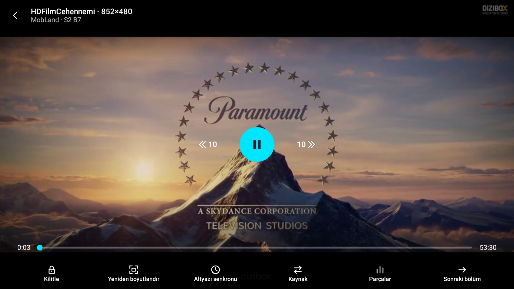
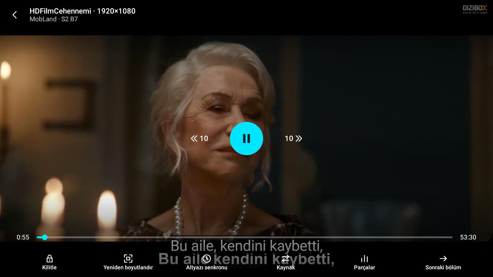
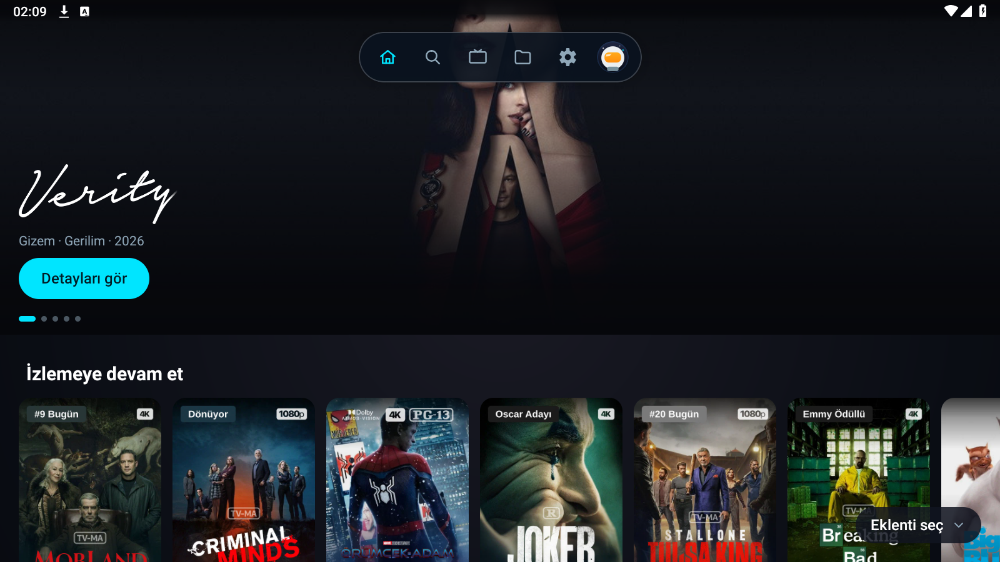

# HDFilmCehennemi 1.0.3 Kalıcı GitHub Deposu Doğrulama Sonuçları

Tarih: 2026-10-31 02:09:14  
Dal: `duzeltme/oynatici-saglamlik`  
Cihaz: PlayNeon-130 (`emulator-5558`)  
Yeni Depo: `https://github.com/liberta09/hdfilmcehennemi-nuvio`  
Yeni Manifest URL: `https://raw.githubusercontent.com/liberta09/hdfilmcehennemi-nuvio/main/manifest.json`  

---

## 1. Doğrulama Ölçüm Tablosu

| İçerik | İstek → Akış (sn) | İlk Görüntü (sn) | Sonuç | Notlar |
|---|---|---|---|---|
| **MobLand S2 B7** | 1.8 sn | **3.84 sn** | BAŞARILI | Sağlayıcı: HDFilmCehennemi; Kaynak: HDFilmCehennemi; rapidrame rplayer aktif; 60 sn konum=0:56, takılma=0 |

---

## 2. Ayrıntılı Değerlendirme

- **Oynatma Durumu:** BAŞARILI
- **İstek Saati:** `02:08:12.269`
- **Akış Bulunma Saati:** `02:08:14.071` (İstek → Akış: **1.8 sn**)
- **İlk Kare Saati:** `02:08:16.110` (İlk Görüntü Süresi: **3.84 sn**)
- **Kullanılan Sağlayıcı:** HDFilmCehennemi
- **Kullanılan Kaynak:** HDFilmCehennemi
- **Oynatıcı Sayfası (rplayer):** Bulundu ve indirildi
- **Akış Listeye Girdi mi:** EVET (rapidrame master.m3u8 listeye girdi)
- **rapidrame CDN Referer Başlıkları:** Doğru biçimde eklendi (Referer, Origin, User-Agent)
- **Doğrulama (verifyStream / İçerik Süresi):** kaynak=HDFilmCehennemi (s231.rapidrame.com) süre=53.5 dk beklenen=54 dk tür=Tv -> Ok
- **60 sn Oynatma:** Konum: `0:56`, Takılma: 0 kez (0.0 sn), Tampon: 23.6 sn
- **Geri Tuşu Kontrolü:** Sorunsuz çalıştı, ana ekrana dönüldü
- **Çökme Günlüğü (logcat -b crash):** Çökme YOK (0)

---

## 3. Ekran Görüntüleri ve Günlükler

- 10 sn Ekran Görüntüsü: 
- 60 sn Ekran Görüntüsü: 
- 60 sn Kumanda/Kontroller: 
- Geri Tuşu Sonrası: 
- Ham Günlük: `mobland-s2e7.log`
- Filtrelenmiş Günlük: `mobland-s2e7-filtered.log`
