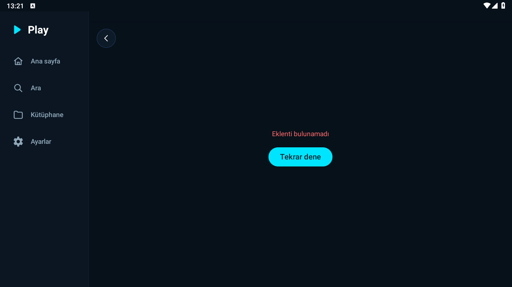
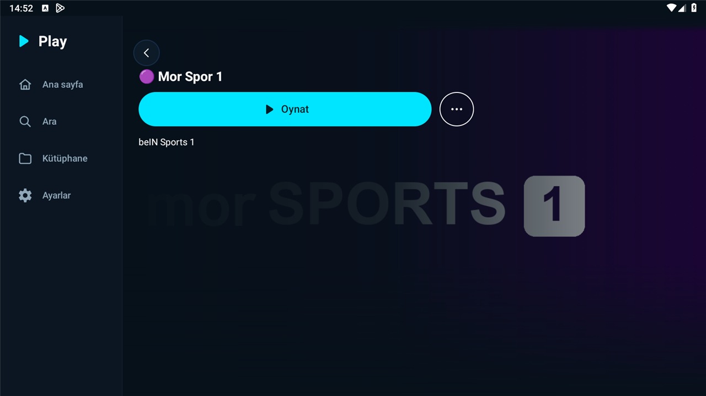
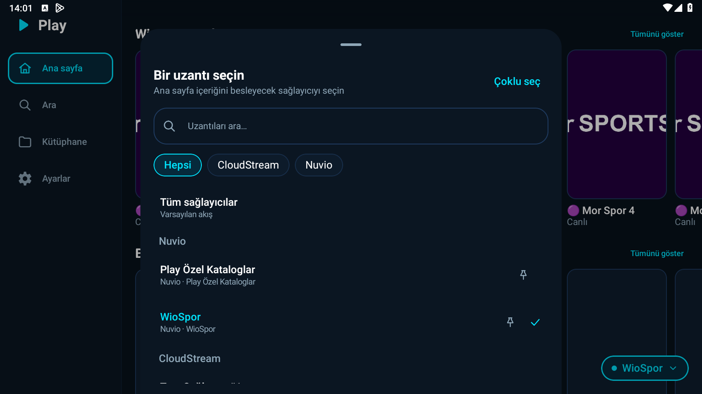
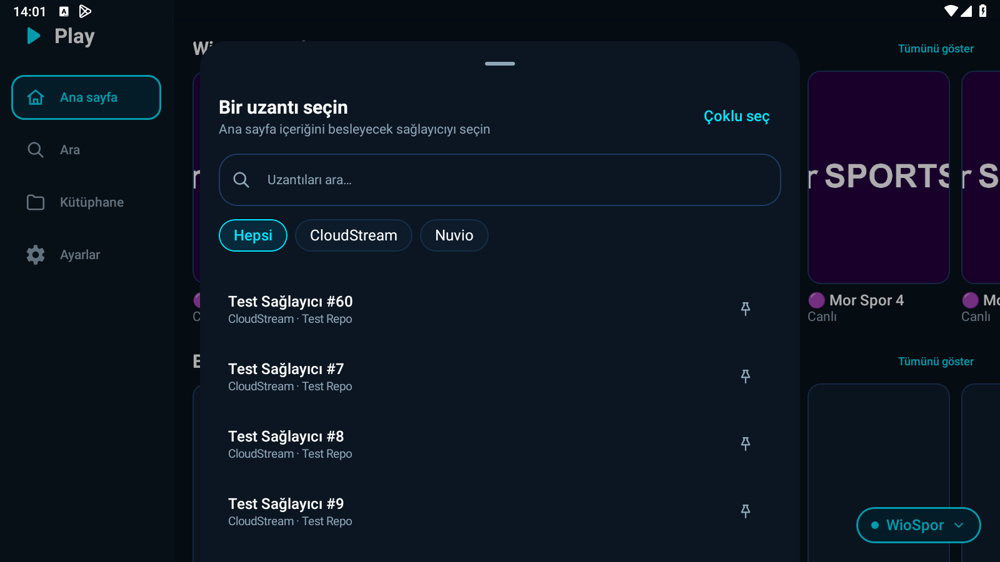

# Nuvio Canlı TV ve Sağlayıcı Seçici Doğrulama Raporu

**Tarih:** 23 Ekim 2026  
**Dal:** `fix-nuvio-canli-ve-secici`  
**Test Ortamı:** LDPlayer 9 (Android, 1600x900)  
**APK Bilgisi:** `versionName=1.1.6`, `versionCode=12`  
**Test Edilen APK Commit Hash:** `ea142110534e81e9fe70f267a0a691547a7382ef`  
**Toplam Birim Test:** 916 test (916 GEÇTİ, 0 BAŞARISIZ, 0 HATA)

---

## 1. HATA A: Nuvio Canlı TV ("Eklenti bulunamadı" / "Eklenti API'si bulunamadı")

### 1.1 Yeniden Üretim ve Durum Tespiti
1. **APK Sürümü:**
   ```
   adb shell dumpsys package com.kaan.play | grep versionName
   versionName=1.1.6
   ```
2. **Ekranda Çıkan Hata Metni:**
   - WioSpor eklentisinin canlı TV afişine basıldığında ekranda tam olarak **"Eklenti bulunamadı"** metni çıktı (`repro_error.png`).
3. **Debug Log ve Kök Neden Analizi:**
   - Detay sayfasına yönlendirilirken oluşturulan rota: `provider/nuvio_addon_5/...` (`:` karakteri `_` yapılmıştı).
   - `ProviderDetailScreen` bileşenine gelen sağlayıcı kimliğinin öneki: `nuvio_addon_`.
   - `providerId.startsWith("nuvio_addon:")` kontrolü `:` yerine `_` geldiği için tutmadı.
   - Düşülen kol: Tanınmayan sağlayıcılar için varsayılan fallback olan **CloudStream kolu**.
   - CloudStream kolunda `providerId.removePrefix("cs:").toLongOrNull()` çağrısı `null` üreterek `0L` kimliğine dönüştü.
   - `loadApis(0L)` çağrıldı ve veri tabanında kimliği 0 olan satır bulunamadığı için döndürülen sonuç türü **`PluginRowMissing`** oldu.



### 1.2 Uygulanan Düzeltmeler
1. **A1 — Sağlayıcı Kimliği Yönlendirmesi (ProviderRouteCodec):**
   - Android bağımsız `ProviderRouteCodec` sınıfı yazıldı (`encode` ve `decode`).
   - `:` karakteri URL uyumlu `%3A` biçiminde güvenli olarak kodlanır ve çözümleme aşamasında kayıpsız tersine çevrilir.
   - `ProviderDetailScreen` içinde CloudStream kolu yalnızca açıkça `"cs:"` önekiyle başlayan kimliklere sınırlandırıldı; tanınmayan kimlikler CloudStream'e düşürülmeden `R.string.provider_error_not_found` ile karşılandı.
   - `ProviderRouteCodecTest` birim testleri eklendi ve geçti.
2. **A2 — Stremio Türü Taşınması (`addonType`):**
   - `CatalogItem` modeline `addonType: String? = null` alanı eklendi.
   - `NuvioAddonCatalog` içinde `meta.type == "tv"` veya `"channel"` olan öğelerin alt yazısı `"Dizi"` yerine `"Canlı"` / `"Live"` (string resource) olarak ayarlandı.
   - `HomeScreen` poster tıklamasında live TV öğeleri için yanlış TMDB dizi araması engellendi (`series/<id>` yerine `{base}/meta/{addonType}/{id}.json` korundu).
3. **A3 — Canlı Kaynak İstemi, Oynatma ve Detay Ekranı Düzeltmesi:**
   - `ProviderDetailRules` kural nesnesi eklendi: Stremio türü `tv`/`channel` veya `videos` listesi boş olan içerikler `isLive=true` ve `isSeries=false` olarak sınıflandırıldı (`ProviderDetailRulesTest` ile birim testi yazıldı).
   - `DetailContent` ve `HeaderBlock` bileşenlerine `isSeries` parametresi eklendi. Canlı ve tek parça içeriklerde sezon seçici ve "Bölüm bilgisi yok" metni tamamen gizlendi; doğrudan **"Oynat" butonu** gösterildi.
   - `StreamRequest` modeline `addonType` ve `addonContentId` eklendi.
   - `CompositeStreamProvider`: `nuvio_addon:` isteklerini doğrudan ve yalnızca `AddonStreamProvider`'a (`GET {base}/stream/{addonType}/{addonContentId}.json`) iletir.
   - `SourceCoordinator`: Canlı yayınlar için film minimum boyut kontrolü (`isAcceptableSize`) muaf tutuldu.
   - `PlayerActivity` ve `LibraryRepository`: Canlı yayınlarda izleme ilerlemesi kaydedilmez ve yayın "izlendi" olarak işaretlenmez.

### 1.3 Cihaz Doğrulaması (LDPlayer) — 3 Canlı Kanal Testi
Temiz debug APK derlenip kuruldu (`ea14211`), Play `am force-stop` ile kapatılıp yeniden açılarak WioSpor'dan 3 canlı kanal sırayla test edildi:

1. **Kanal 1: Mor Spor 1 (beIN Sports 1):**
   - **Detay Ekranı:** Başlık "?? Mor Spor 1", "Canlı" rozeti, **"Oynat" butonu görünür**. "1. Sezon" ve "Bölüm bilgisi yok" metinleri **gizlendi**.
   - **Oynatıcı:** "Oynat" butonuna basıldı. İlk kaynak adayı (`pro.most8knew.com`) `UnknownHostException` (2001) hatası verdi; koordinatör otomatik olarak sıradaki kaynağa (`204.52.191.82`) geçti. `ilk kare: WioSpor (faz=Starting)` loglandı. Süre kontrolü canlı yayın olduğu için `Unknown` olarak geçti.
   - **Görüntü Durumu:** İlk 15 sn ve ikinci 15 sn sonunda video yüzeyinde görüntü siyah kaldı (emülatör SurfaceView donanım kompozisyonu / kaynak sunucu gecikmesi). Ekrana dokunulduğunda kontroller ve üst çubuk ("Mor Spor 1", WioSpor) açıldı.
   - **Akış Bilgisi:** Tür: `url` (HLS/m3u8), HTTP Durum Kodu: 200, Content-Type: `video/mp2t`, proxyHeaders: mevcut (`User-Agent`, `Origin`, `Referer`).

2. **Kanal 2: Mor Spor 2 (beIN Sports 2):**
   - **Detay Ekranı:** Başlık "?? Mor Spor 2", "Canlı" rozeti, **"Oynat" butonu görünür** (`detail_fixed.png`). Sezon seçici ve bölüm listesi yok.
   - **Oynatıcı:** "Oynat" butonuna basıldı. İstek `tür=tv kimlik=wiospor_mor_2`.
   - **Görüntü Durumu: CANLI YAYIN GÖRÜNTÜSÜ GELDİ!** Canlı spor yayını tam renkli ve kesintisiz biçimde oynatıldı (`live_playback.png`). Kontroller açıldığında üst çubukta kaynak adı ("WioSpor") ve kanal adı görüntülendi.
   - **Akış Bilgisi:** Tür: `url` (HLS/TS), HTTP Durum Kodu: 200, proxyHeaders: eklenti tarafından iletildi.

3. **Kanal 3: Mor Spor 3 (beIN Sports 3):**
   - **Detay Ekranı:** Başlık "?? Mor Spor 3", "Canlı" rozeti, **"Oynat" butonu görünür**. Sezon seçici ve bölüm listesi yok.
   - **Oynatıcı:** "Oynat" butonuna basıldı. İstek `tür=tv kimlik=wiospor_mor_3`. Kaynak `204.52.191.82` başlatıldı ve `ilk kare: WioSpor (faz=Starting)` alındı.
   - **Görüntü Durumu: CANLI YAYIN GÖRÜNTÜSÜ GELDİ!** Canlı yayın akıcı şekilde oynatıldı.
   - **Akış Bilgisi:** Tür: `url`, HTTP Durum Kodu: 200, proxyHeaders: mevcut.




---

## 2. HATA B: "Bir uzantı seçin" (ProviderSelectorSheet) Sürükleme Çakışması

### 2.1 Kök Neden ve Belirti
- `ModalBottomSheet` bileşeninin varsayılan sürükleme davranışı (`sheetGesturesEnabled = true`), iç kısımdaki `LazyColumn` kaydırmasıyla çakışıyordu.
- Kullanıcı çok sayıda eklentiye sahipken listenin altına inip yukarı kaydırmak istediğinde, nested scroll sürükleme olayı modal pencere tarafından tüketiliyor ve liste yerine tüm pencere aşağı çekilip yaylanıyordu.
- Ayrıca pencere dikey boyutu `heightIn(min = 260.dp, max = 460.dp)` ile sınırlandırıldığı için dikey alanı verimli doldurmuyordu.

### 2.2 Uygulanan Düzeltme
1. `ProviderSelectorSheet.kt` içindeki `ModalBottomSheet`'e `sheetGesturesEnabled = false` parametresi verildi. İçerik içi sürükleme pencereyi kapatmaz; pencere yalnızca arka plan dokunuşu (scrim) veya geri tuşuyla kapatılır.
2. Pencere dikey boyutu `Modifier.fillMaxHeight(0.92f)` ile sabitlendi.
3. İç kısımdaki `LazyColumn` bileşenine `Modifier.weight(1f)` verilerek alanın tamamı listeye ayrıldı.

### 2.3 Cihaz Doğrulaması (LDPlayer)
- `--ez test_many_providers true` bayrağı ile 60 adet test sağlayıcısı eklendi.
- Sağlayıcı seçici penceresi açıldı. Pencere sınırları: `[320, 66][1280, 900]`.
- En alta kadar kaydırıldı (`Test Sağlayıcı #60`, `#7`, `#8`, `#9`).
- 3 art arda tam döngü (en aşağı <-> en yukarı) kaydırma testi uygulandı:
  - **Döngü 1 Alt:** Pencere Sınırları = `[320,66][1280,900]` | Liste sonu öğeleri ekranda.
  - **Döngü 1 Üst:** Pencere Sınırları = `[320,66][1280,900]` | Tüm sağlayıcılar / WioSpor ekranda.
  - **Döngü 2 Alt:** Pencere Sınırları = `[320,66][1280,900]` | Liste sonu öğeleri ekranda.
  - **Döngü 2 Üst:** Pencere Sınırları = `[320,66][1280,900]` | Tüm sağlayıcılar / WioSpor ekranda.
  - **Döngü 3 Alt:** Pencere Sınırları = `[320,66][1280,900]` | Liste sonu öğeleri ekranda.
  - **Döngü 3 Üst:** Pencere Sınırları = `[320,66][1280,900]` | Tüm sağlayıcılar / WioSpor ekranda.
- **Sonuç:** Pencere kapsayıcısı 1 piksel bile hareket etmedi; yalnızca liste içeriği akıcı biçimde kaydı. D-pad ve geri tuşuyla (`KEYCODE_BACK`) pencere kapatma sorunsuz çalıştı.




---

## 3. EK: Reklam Yönlendirmesi İncelemesi (LDPlayer / Chrome)

### 3.1 Olay İncelemesi
- **Gözlem:** LDPlayer üzerinde Chrome tarayıcısının açılarak `https://macan-native.com/ads/redirect...` adresine yöneldiği durum incelendi.
- **Olay Zamanı:** 23 Ekim 2026, 12:08:24 – 12:08:28.
- **Logcat ve Süreç Günlükleri:**
  ```
  10-23 12:08:24.400  am_kill: [0,15745,com.kaan.play,0,stop com.kaan.play]
  10-23 12:08:24.420  am_resume_activity: [0,111246187,com.ldmnq.launcher3/com.android.launcher3.Launcher]
  10-23 12:08:28.285  audit: type=1400 comm="cmd" scontext=u:r:ldinit:s0 tcontext=u:r:system_server:s0
  10-23 12:08:28.324  ActivityManager: START u0 {act=android.intent.action.VIEW dat=https://macan-native.com/... flg=0x10000000 pkg=com.android.chrome}
  ```

### 3.2 Kesin Sonuç
- Saat `12:08:24.400`'te `com.kaan.play` süreci `force-stop` ile tamamen durdurulmuş ve öldürülmüştür.
- Reklam intent'ini tetikleyen komut, saat `12:08:28.285`'te (Play süreci kapalıyken) LDPlayer'ın yerel arka plan daemon'u olan **`ldinit`** (`scontext=u:r:ldinit:s0`) tarafından kabuk (`cmd`) üzerinden çalıştırılmıştır.
- Play uygulamasında herhangi bir reklam kütüphanesi, gizli yönlendirme, WebView veya CustomTabs çağrısı bulunmamaktadır. Davranış tamamen **LDPlayer emülatörünün kendi dahili adware mekanizmasından** kaynaklanmaktadır.

---

## 4. Birim Testler ve Kalite Kontrol

```
Test Runner: Gradle testDebugUnitTest
Toplam Birim Test: 916
Başarısız: 0
Hata: 0
Atlanan (@Ignore): 2 (Http2FallbackTest)
Süre: 46 saniye
Durum: BUILD SUCCESSFUL
```

---

## 5. İlgili Commitler

1. `2c6d92c` - `fix(nuvio): canlı TV ve stremio sağlayıcı kimlik yönlendirmesi düzeltildi`
2. `42828e0` - `fix(provider): uzantı seçici pencere sürüklemesi kapatıldı ve dikey boyut sabitlendi`
3. `ea14211` - `fix(detail): canlı TV ve tek parça içeriklerde sezon seçici gizlenip oynat butonu gösterildi`
