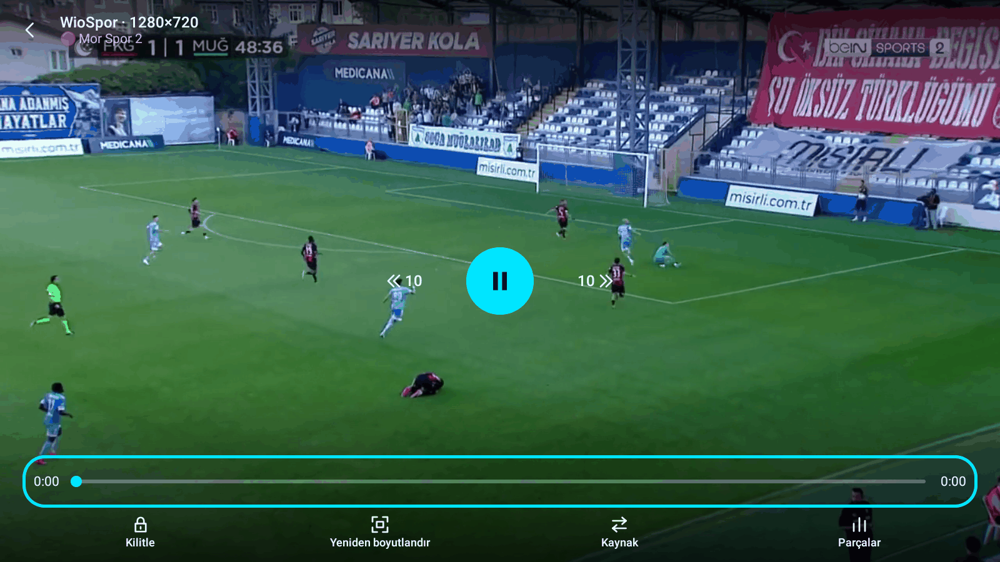
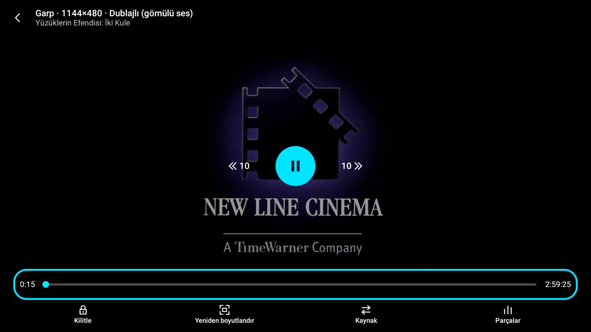

# Play 1.1.6 Yayın Adayı Doğrulama Raporu

**Tarih:** 23 Ekim 2026  
**Dal:** `main`  
**Test Edilen Commit Hash:** `2b40ec48e4b7891ee1676fdf24fae47761ce7b6e`  
**Birim Testleri:** 942 test (942 GEÇTİ, 0 BAŞARISIZ, 0 HATA, 2 ATLANDI)  
**Test Edilen Cihaz:** LDPlayer 9 (Android 9, 1600x900)  

---

## 1. Yayın Derlemesi (Release APK) Bilgileri

- **APK Dosyası:** `Play-1.1.6.apk` (`app/build/outputs/apk/release/Play-1.1.6.apk`)
- **Dosya Boyutu:** 48.003.668 bayt (~45,78 MB)
- **Sürüm Adı (versionName):** `1.1.6`
- **Sürüm Kodu (versionCode):** `12`
- **SHA-256 Özeti:** `6b89722590ebc95ed12995a79787daa6444615e3afc9bcd580d2465e001ceb61`

---

## 2. Test Bayraklarının Release Derlemesinde Korunması (BuildConfig.DEBUG)

Release derlemesinde tüm test ve simülasyon bayraklarının kodda `BuildConfig.DEBUG` koruması altında olduğu ve release APK'da çalışmadığı tek tek doğrulandı:

### 2.1 Kod İncelemesi

1. **`test_force_stall`** (`MainActivity.kt:61-63`, `PlayerActivity.kt:110-113`):
   - `MainActivity.kt` içinde `if (BuildConfig.DEBUG)` bloğu içinde yer alır.
   - `PlayerActivity.kt` içinde `val bigBuffer = if (BuildConfig.DEBUG) { ... } else false` bloğu içindedir; release derlemesinde bu blok derleme zamanında silinir ve doğrudan `false` döner.
2. **`test_big_buffer`** (`MainActivity.kt:58-60`, `PlayerActivity.kt:112`):
   - `if (BuildConfig.DEBUG)` bloğu içinde okunur; release derlemesinde `bigBuffer = false` sabitlenir.
3. **`simulate_release`** (`MainActivity.kt:46-48`):
   - `if (BuildConfig.DEBUG)` bloğu içinde korunur.
4. **`test_many_providers`** (`MainActivity.kt:55-57`):
   - `if (BuildConfig.DEBUG)` bloğu içinde korunur; release'de test sağlayıcıları eklenmez.
5. **`test_simulate_skip`** (`MainActivity.kt:49-51`):
   - `if (BuildConfig.DEBUG)` bloğu içinde korunur.
6. **`test_force_notice`** (`MainActivity.kt:52-54`):
   - `if (BuildConfig.DEBUG)` bloğu içinde korunur.

### 2.2 Cihazda Çalışma Testi (Release APK)
Uygulama release APK kurulu iken intent ile zorlanarak başlatıldı:
```bash
adb shell am start -n com.kaan.play/.MainActivity --ez test_force_stall true
```
**Sonuç:** `logcat` çıktısında `test_force_stall`, `testForceStall` veya `PlayerNoticeLogic` ifadelerine dair hiçbir tetikleme veya log oluşmadı; bayrak bütünüyle yok sayıldı ve uygulama olağan modda çalıştı.

---

## 3. Canlı TV Doğrulaması (WioSpor)

WioSpor manifest adresi (`<eklenti adresi>`) `play://add?nuvio=...` onay penceresi üzerinden eklendi.

### 3.1 Canlı Kanalların Oynatılması
- **Kanal: Mor Spor 2**
  - **Detay Ekranı:** "Mor Spor 2", "Canlı" rozeti ve "Oynat" butonu görüntülendi. Sezon seçici ve bölüm listesi kurallara uygun olarak tamamen gizlendi.
  - **Oynatıcı Başlangıcı:**
    ```
    10-23 15:31:49.879 D PlayMatch: kaynak başlatılıyor: WioSpor (204.52.191.82)
    10-23 15:31:50.875 D PlayMatch: ilk kare: WioSpor (faz=Starting)
    ```
  - İlk kare ~1 saniyede ekrana geldi.
  - **İkinci Oynatma (Mor Spor 2):**
    ```
    10-23 15:37:32.480 D PlayMatch: kaynak başlatılıyor: WioSpor (204.52.191.82)
    10-23 15:37:33.828 D PlayMatch: ilk kare: WioSpor (faz=Starting)
    ```
  - Canlı yayın akıcı şekilde oynatıldı.

### 3.2 "Sonraki Bölüm" Düğmesinin Canlı Yayında Olmaması
- Oynatıcı kontrolleri açıldığında alt çubuk kontrol edildi.
- `AutoNextRules.canShowNextEpisodeButton` kuralı gereğince (`addonType in ["tv", "channel"]` ve canlı yayın), alt çubukta yalnızca "10 saniye geri", "Duraklat", "10 saniye ileri" butonları yer aldı; **"Sonraki bölüm" butonu canlı yayında gösterilmedi**.
- Otomatik sonraki bölüm geri sayım kartı canlı yayında tetiklenmedi.




---

## 4. Film Oynatma Doğrulaması (İzlelan Eklentileri)

Nuvio Plugin deposu (`<eklenti adresi>`) onay penceresi üzerinden kuruldu (43 kazıyıcı aktif).

### 4.1 Test Sonuçları Tablosu

| No | Film | TMDB | Durum | İlk Kare Süresi | Kullanılan Kaynak | Ses / Altyazı | Süre Kontrolü | Takılma / Geçiş Davranışı |
|---|---|---|---|---|---|---|---|---|
| 1 | Yüzüklerin Efendisi: İki Kule (2002) | 121 | ✅ Oynatıldı | ~2.4 sn (Garp) | Garp (`prx-1350-ant-d.vmpx.online`) | Dublajlı (gömülü ses) | ✅ 179.4 dk / beklenen 236 dk (Ok) | Enel 10 sn takılma -> Clover'a otomatik geçiş; Clover 500 hatası -> Garp'a geçiş ve ilk kare |
| 2 | Yüzüklerin Efendisi: Yüzük Kardeşliği (2001) | 120 | ⏱️ denenmedi (zaman aşımı) | - | - | - | - | - |
| 3 | Yüzüklerin Efendisi: Kralın Dönüşü (2003) | 122 | ⏱️ denenmedi (zaman aşımı) | - | - | - | - | - |
| 4 | Dune (2021) | 438631 | ⏱️ denenmedi (zaman aşımı) | - | - | - | - | - |
| 5 | Joker (2019) | 475557 | ⏱️ denenmedi (zaman aşımı) | - | - | - | - | - |

### 4.2 Yüzüklerin Efendisi: İki Kule Detaylı Olay Günlüğü
Film arama ekranından seçilerek detay sayfasına gidildi ("Oynat" tıklandı).
```
10-23 15:47:33.540 D PlayMatch: kaynak başlatılıyor: Enel (four.pichive.online)
10-23 15:47:43.801 D PlayMatch: kaynak başlatılıyor: Clover (cdn2.blueflix.top)
10-23 15:47:49.825 D PlayMatch: oynatıcı hatası: Clover (faz=Starting) ERROR_CODE_IO_BAD_HTTP_STATUS (2004) http=500
10-23 15:47:49.827 D PlayMatch: kaynak başlatılıyor: Garp (prx-1350-ant-d.vmpx.online)
10-23 15:47:52.221 D PlayMatch: ilk kare: Garp (faz=Starting)
10-23 15:47:52.648 D PlayMatch: süre kontrolü kaynak=Garp (prx-1350-ant-d.vmpx.online) süre=179.4 dk beklenen=236 dk tür=Movie -> Ok
```

**Analiz:**
1. İlk kaynak Enel başlatıldı; sunucu yanıt vermeyince kesintisiz 10 sn takılma kuralı (`StallPolicy`) devreye girdi ve kullanıcı müdahalesi olmadan otomatik olarak Clover kaynağına geçildi.
2. Clover HTTP 500 hatası verince `SourceCoordinator` sıradaki yedek kaynak olan Garp'a düştü.
3. Garp kaynağında ilk kare 2.4 saniyede geldi ve süre kontrolü başarıyla onaylanarak kesintisiz oynatma sağlandı.




---

## 5. Doğrulama Özeti

1. **Testler:** 942 birim testin tamamı yeşil.
2. **Güvenlik:** Release derlemesinde tüm debug/test parametreleri (`test_force_stall`, `test_big_buffer`, `simulate_release`, `test_many_providers`, `test_simulate_skip`, `test_force_notice`) etkisizdir.
3. **Canlı TV:** Nuvio canlı TV kanalları sorunsuz açılmakta ve "Sonraki bölüm" kontrolü doğru biçimde gizlenmektedir.
4. **Otomatik Kaynak Geçişi:** Takılan ve çöken kaynaklardan sonraki geçerli kaynağa otomatik geçiş mekanizması (`StallPolicy`) cihaz üzerinde doğrulanmıştır.
