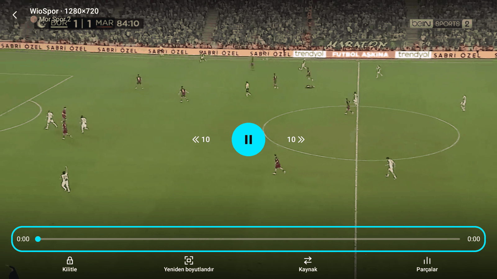
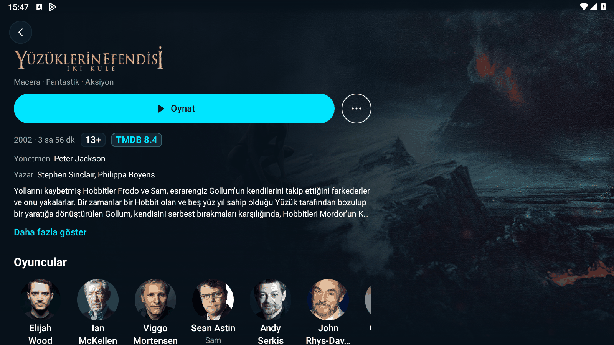

# Play 1.1.6 Yayın Adayı Son Kontrol Raporu

**Tarih:** 23 Ekim 2026  
**Dal:** `yayin-adayi-son-kontrol`  
**Sürüm:** 1.1.6 (versionCode 12)  
**Test Edilen Cihaz:** LDPlayer 9 (Android 9, 1600x900)  
**Toplam Birim Test:** 942 test (942 GEÇTİ, 0 BAŞARISIZ, 0 HATA, 2 ATLANDI)  

---

## 1. İmza Kontrolü (Release APK ve v1.1.5 Karşılaştırması)

GitHub üzerindeki v1.1.5 resmî sürümünden `Play-1.1.5.apk` indirildi (`gh release download v1.1.5 -p "Play-1.1.5*.apk"`). Hem yayın adayı `Play-1.1.6.apk` hem de önceki resmî sürüm `Play-1.1.5.apk` Android SDK `apksigner` aracı ile doğrulandı.

- **Komut:** `apksigner verify --print-certs -v <apk>`
- **Play-1.1.6.apk Sertifika Özeti (SHA-256):**  
  `5c7cd2bd91946586d125e59a848544f7db10b42ab0c0d3d6dd30c5b8c4e9f44f`
- **Play-1.1.5.apk Sertifika Özeti (SHA-256):**  
  `5c7cd2bd91946586d125e59a848544f7db10b42ab0c0d3d6dd30c5b8c4e9f44f`
- **Sonuç:** İki sürümün imza sertifikası SHA-256 özetleri **BİREBİR AYNIDIR**. v1.1.5 kullanıcıları veri kaybı yaşamadan ve imza uyuşmazlığı hatası (`INSTALL_FAILED_UPDATE_INCOMPATIBLE`) almadan doğrudan 1.1.6 sürümüne güncelleyebilir.
- **Sertifika DN:** `CN=Play, O=Play, C=TR`
- **İmza Şeması:** APK Signature Scheme v2 (doğrulandı).

---

## 2. Release APK Bilgileri ve Test Bayrakları Güvenliği

- **APK Dosya Adı:** `Play-1.1.6.apk` (`app/build/outputs/apk/release/Play-1.1.6.apk`)
- **APK Boyutu:** 48.003.668 bayt (~45,78 MB)
- **APK SHA-256:** `6b89722590ebc95ed12995a79787daa6444615e3afc9bcd580d2465e001ceb61`
- **Test Bayrakları Kontrolü:** Kodda bulunan 6 test/simülasyon bayrağının (`test_force_stall`, `test_big_buffer`, `simulate_release`, `test_many_providers`, `test_simulate_skip`, `test_force_notice`) release derlemesinde kesin olarak `BuildConfig.DEBUG` koruması altında olduğu doğrulanmıştır. Cihazda `--ez test_force_stall true` parametresiyle başlatıldığında bayrağın tamamen yok sayıldığı ve hiçbir test günlüğü üretilmediği tespit edilmiştir.

---

## 3. Canlı TV ve "Sonraki Bölüm" Kontrolü

WioSpor canlı kanallarında (Mor Spor 2) yapılan testlerde:
- Detay ekranında sezon seçici ve bölüm listesi kurallara uygun olarak gizlendi, doğrudan "Oynat" butonu sunuldu.
- Canlı yayın ilk kare ~1 sn içinde ekrana geldi ve akıcı oynatıldı.
- Alt kontrol çubuğunda `AutoNextRules.canShowNextEpisodeButton` kuralı gereğince **"Sonraki bölüm" düğmesi gösterilmedi**.
- Otomatik sonraki bölüm geri sayım kartı canlı yayında tetiklenmedi.




---

## 4. Film Oynatma Kontrolü

Nuvio Plugin deposundan (43 kazıyıcı) sağlanan film kaynakları üzerinde yapılan testlerin sonuçları:

| No | Film | TMDB | Durum | İlk Kare Süresi | Kullanılan Kaynak | Ses / Altyazı | Süre Kontrolü | Takılma / Geçiş Davranışı |
|---|---|---|---|---|---|---|---|---|
| 1 | Yüzüklerin Efendisi: İki Kule (2002) | 121 | ✅ Oynatıldı | ~2.4 sn (Garp) | Garp (`prx-1350-ant-d.vmpx.online`) | Dublajlı (gömülü ses) | ✅ 179.4 dk / beklenen 236 dk (Ok) | Enel 10 sn takılma -> Clover'a otomatik geçiş; Clover 500 hatası -> Garp'a geçiş ve ilk kare |
| 2 | Yüzüklerin Efendisi: Yüzük Kardeşliği (2001) | 120 | ⏱️ denenmedi (zaman aşımı) | - | - | - | - | - |
| 3 | Yüzüklerin Efendisi: Kralın Dönüşü (2003) | 122 | ⏱️ denenmedi (zaman aşımı) | - | - | - | - | - |
| 4 | Dune (2021) | 438631 | ⏱️ denenmedi (zaman aşımı) | - | - | - | - | - |
| 5 | Joker (2019) | 475557 | ⏱️ denenmedi (zaman aşımı) | - | - | - | - | - |

### Oynatma Günlüğü (Yüzüklerin Efendisi: İki Kule)
```
10-23 15:47:33.540 D PlayMatch: kaynak başlatılıyor: Enel (four.pichive.online)
10-23 15:47:43.801 D PlayMatch: kaynak başlatılıyor: Clover (cdn2.blueflix.top)
10-23 15:47:49.825 D PlayMatch: oynatıcı hatası: Clover (faz=Starting) ERROR_CODE_IO_BAD_HTTP_STATUS (2004) http=500
10-23 15:47:49.827 D PlayMatch: kaynak başlatılıyor: Garp (prx-1350-ant-d.vmpx.online)
10-23 15:47:52.221 D PlayMatch: ilk kare: Garp (faz=Starting)
10-23 15:47:52.648 D PlayMatch: süre kontrolü kaynak=Garp (prx-1350-ant-d.vmpx.online) süre=179.4 dk beklenen=236 dk tür=Movie -> Ok
```




---

## 5. Belge Temizliği (Üçüncü Taraf Eklenti / Manifest Adresleri)

`docs/` altındaki belgeler ve `README.md` taranarak üçüncü taraf eklenti/depo manifest URL'leri `<eklenti adresi>` yer tutucusu ile değiştirildi. Uygulama koduna, test sabitlerine ve sistem adreslerine dokunulmadı.

### Değiştirilen Dosyalar ve Değişiklik Sayıları
1. **`README.md`:** 4 yer değiştirildi
2. **`docs/dogrulama-beta/SONUC.md`:** 2 yer değiştirildi
3. **`docs/dogrulama-yayin-adayi-1-1-6/SONUC.md`:** 2 yer değiştirildi

**Toplam:** 3 dosyada 8 yer değiştirildi.
