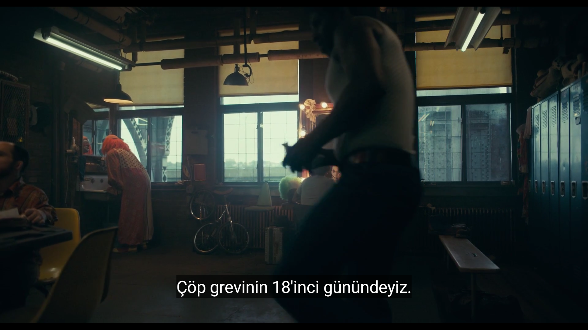
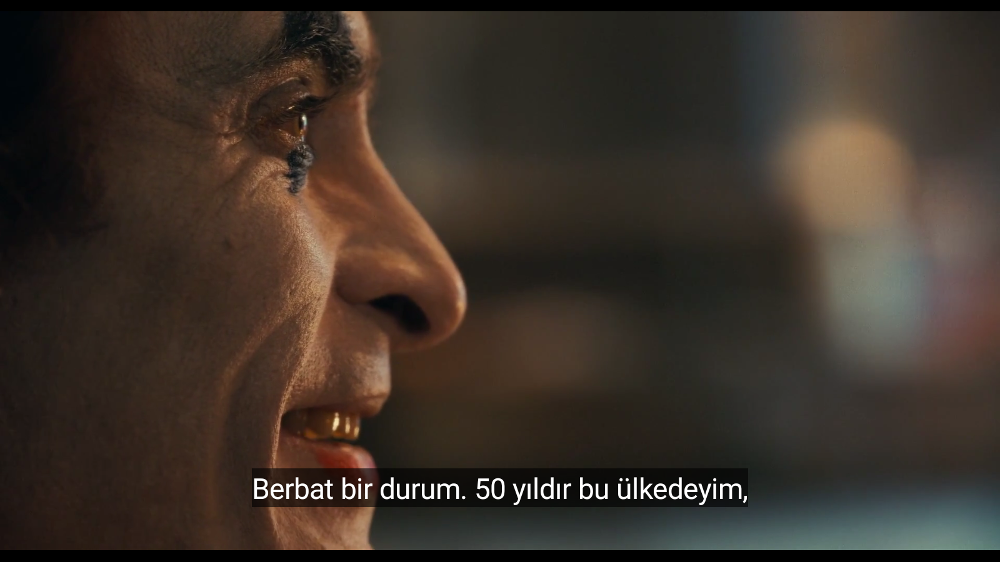
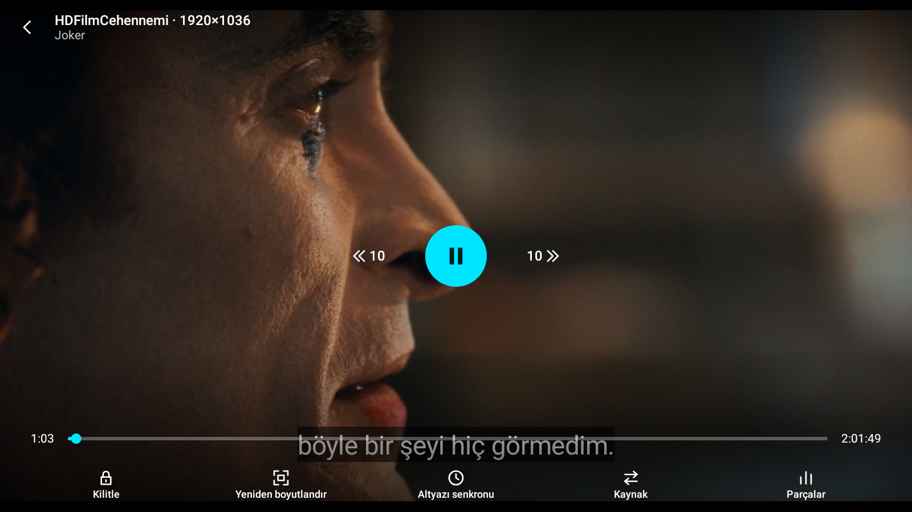
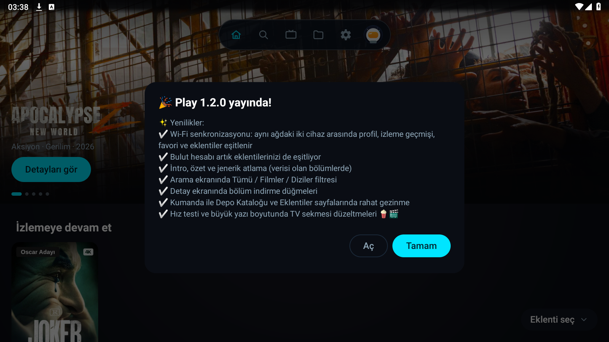
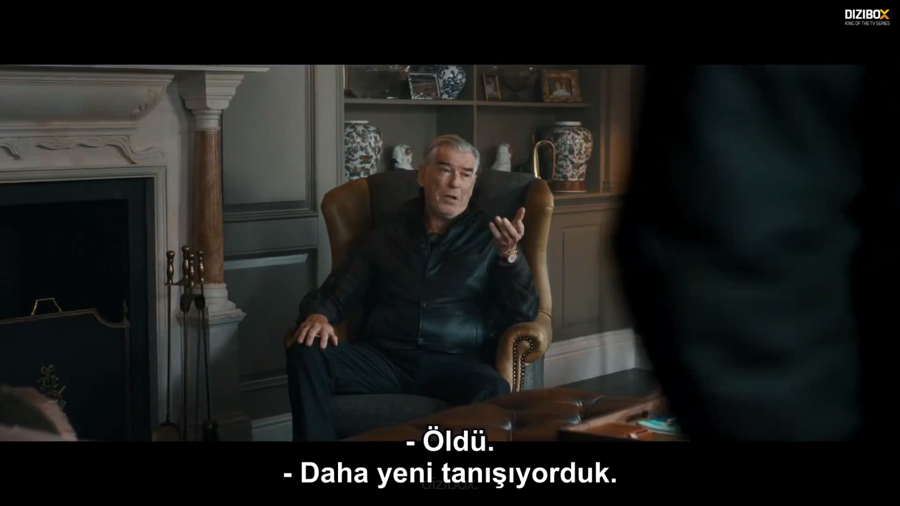
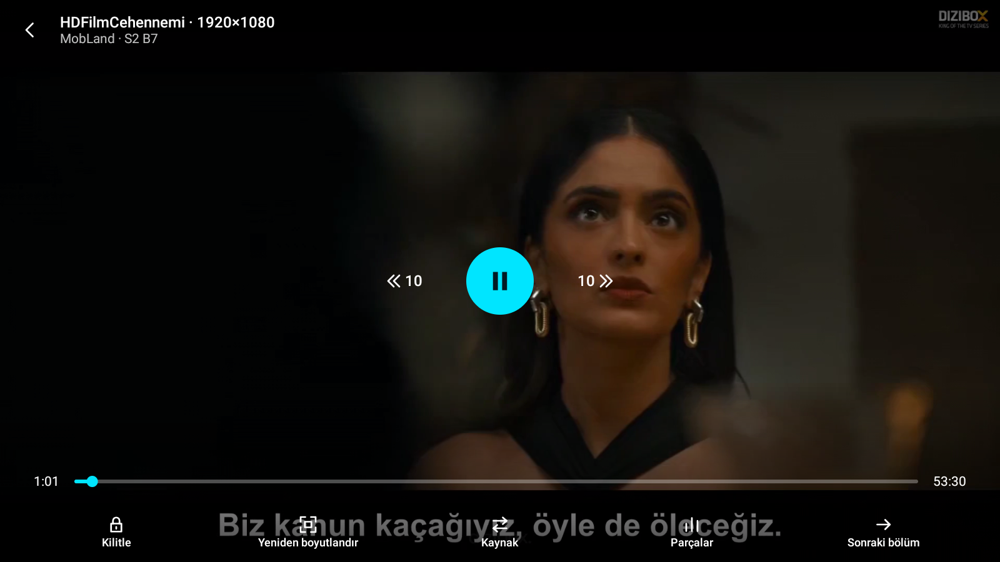
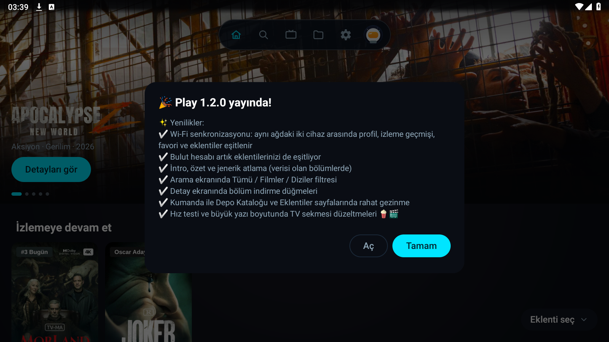

# Play 1.2.2 Yayın Doğrulama Sonuçları (Release APK)

**Tarih / Saat:** 2026-10-31 03:40:00 (TSİ)  
**Sürüm:** Play `1.2.2` (versionCode: `29`, R8 etkin release derlemesi)  
**APK Dosyası:** `Play-1.2.2.apk` (48,609,430 bayt)  
**SHA-256:** `7a5f5cde520ba689aab87bc17deb921388ab0958a43e1df504639d10f2adf4bc`  
**İmza Sertifikası (SHA-256):** `5c7cd2bd91946586d125e59a848544f7db10b42ab0c0d3d6dd30c5b8c4e9f44f` (v1.2.1 ile %100 eşleşti)  
**Cihaz:** PlayNeon-130 (`emulator-5558`)  
**Eklenti Deposu:** `https://raw.githubusercontent.com/liberta09/hdfilmcehennemi-nuvio/main/manifest.json` (HDFilmCehennemi v1.0.3)

---

## 1. Release APK Test Sonuç Tablosu

| İçerik | Tür | Sağlayıcı / Kaynak CDN | İstek → Akış (sn) | İlk Görüntü (sn) | 60 sn Oynatma & Takılma | Tampon | Geri Tuşu | Çökme (Crash Log) |
|---|---|---|---|---|---|---|---|---|
| **Joker (2019)** | MOVIE | HDFilmCehennemi (`srv12.cdnimages1159.shop`) | 1.85 sn | **2.97 sn** | **0 takılma (0.0 sn)** | 30.0 sn | Başarılı | **YOK (0)** |
| **MobLand S2 B7** | TV | HDFilmCehennemi (`s231.rapidrame.com`) | 1.29 sn | **1.96 sn** | **0 takılma (0.0 sn)** | 18.0 sn | Başarılı | **YOK (0)** |

---

## 2. Ayrıntılı Ölçümler

### a) Joker (2019)
- **TMDb ID:** `475557`, IMDb: `tt7286456`
- **İstek Saati:** `03:37:29.287`
- **Akış Saati:** `03:37:31.138` (İstek → Akış: 1.85 sn)
- **İlk Kare Saati:** `03:37:32.255` (İlk Görüntü: **2.97 sn**)
- **Süre Kontrolü:** `süre=121.8 dk beklenen=122 dk tür=Movie -> Ok`
- **60 sn Oynatma:** `sayı=0 toplam=0.0 sn oynama=1 dk`, bantTahmini: 62.75 Mbps, tampon: 30.0 sn
- **Geri Tuşu:** Sorunsuz ana ekrana döndü
- **Çökme Günlüğü (`logcat -b crash`):** Temiz (0)

### b) MobLand S2 B7
- **TMDb ID:** `247718`, IMDb: `tt14940562`, Sezon 2 Bölüm 7
- **İstek Saati:** `03:38:39.989`
- **Akış Saati:** `03:38:41.280` (İstek → Akış: 1.29 sn)
- **İlk Kare Saati:** `03:38:41.947` (İlk Görüntü: **1.96 sn**)
- **rplayer & CDN:** rapidrame master.m3u8 çözüldü, referer başlıkları uygulandı
- **Süre Kontrolü:** `süre=53.5 dk beklenen=54 dk tür=Tv -> Ok`
- **60 sn Oynatma:** `sayı=0 toplam=0.0 sn oynama=1 dk`, bantTahmini: 96.52 Mbps, tampon: 18.0 sn
- **Geri Tuşu:** Sorunsuz ana ekrana döndü
- **Çökme Günlüğü (`logcat -b crash`):** Temiz (0)

---

## 3. Ekran Görüntüleri ve Günlük Dosyaları

- Joker Ekran Görüntüleri:
  - 20 sn: 
  - 60 sn: 
  - 60 sn Kontroller: 
  - Geri Tuşu: 
- MobLand Ekran Görüntüleri:
  - 20 sn: 
  - 60 sn: 
  - 60 sn Kontroller: 
  - Geri Tuşu: 
- Günlükler:
  - Ham: `joker.log`, `mobland.log`
  - Filtrelenmiş: `joker-filtered.log`, `mobland-filtered.log`
